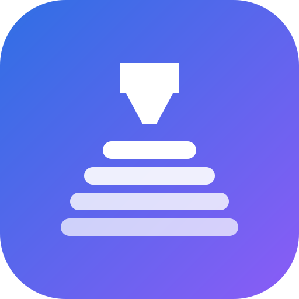
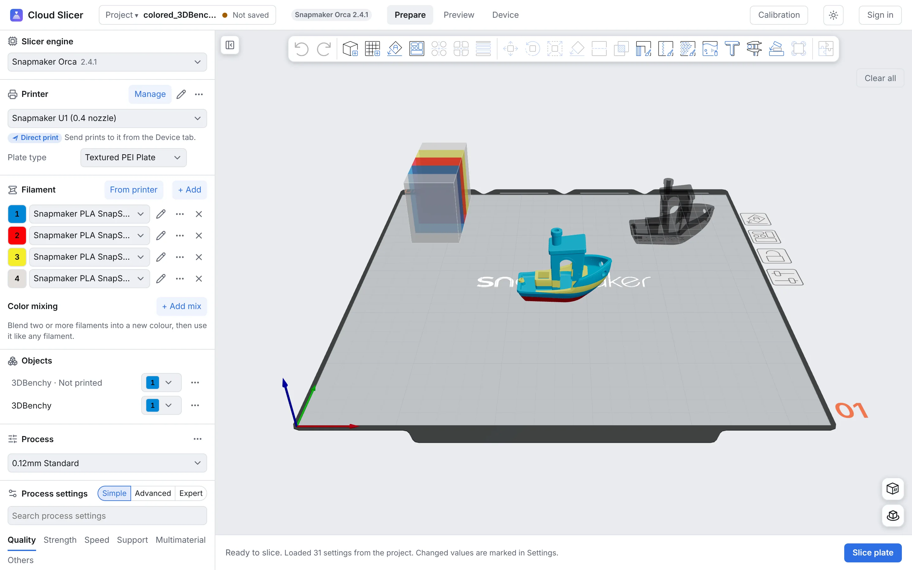
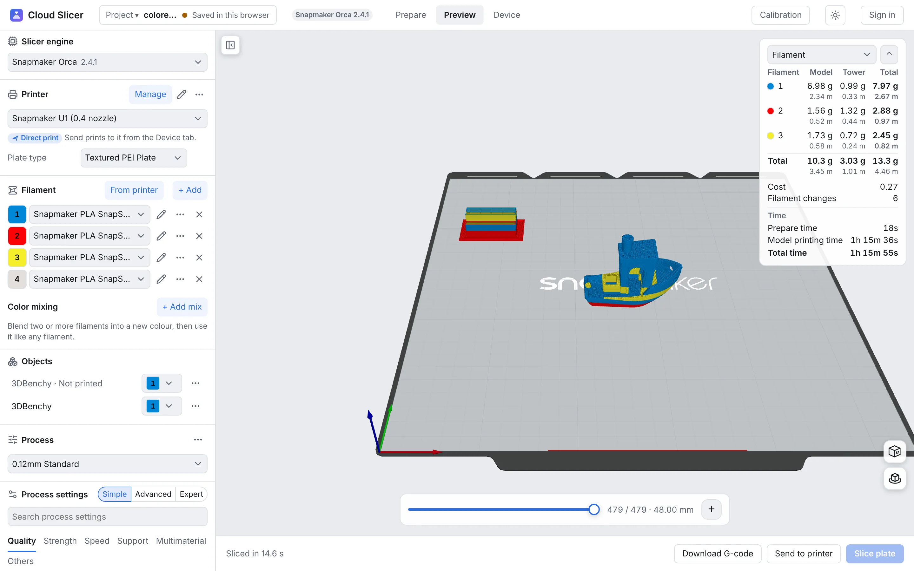
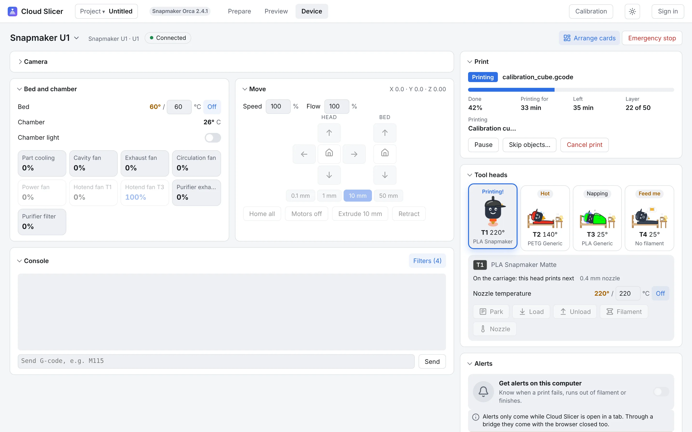
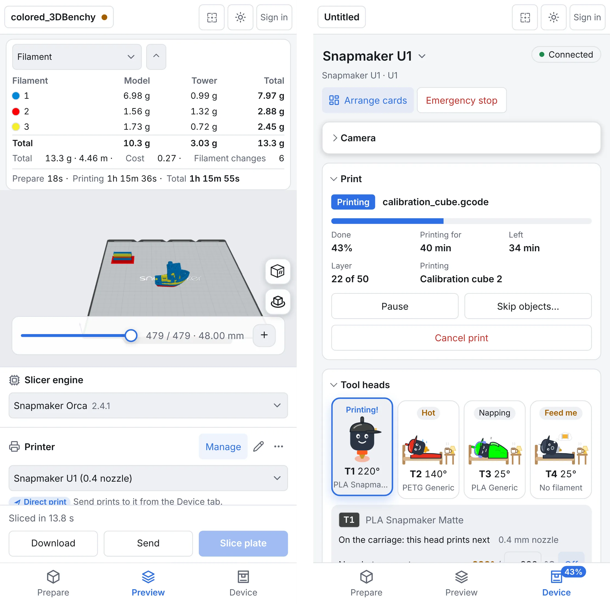

<div align="center">



# Cloud Slicer

**A full OrcaSlicer in your browser, on your laptop and your phone.**
Slice, send and watch your prints from anywhere. Nothing to install.

[**Open Cloud Slicer →**](https://slicer.awesomestuff.qzz.io)


<picture>
  <source media="(prefers-color-scheme: dark)" srcset="docs/images/prepare-dark.webp" />
  
</picture>

</div>

## Why Cloud Slicer

- **The real engine, not a lookalike.** OrcaSlicer's own slicing code runs right in the
  browser tab, so your G-code matches desktop. Pick Snapmaker Orca 2.4.1 or OrcaSlicer
  2.5 per project.
- **Works on a phone.** One app that fits a big screen and a small one, with tabs at the
  bottom on phones. Install it to your home screen like any app.
- **Your printers, from anywhere.** The Device tab shows the camera, temperatures, tool
  heads and files, and sends prints. Alerts reach your phone when a print fails, runs out
  of filament or finishes.
- **Your projects stay yours.** Sign in with Google and projects save to your own Google
  Drive. Or skip sign-in and download the 3MF.
- **Free and open.** No ads, no telemetry, no account needed to slice.

## Features

### Prepare like desktop

Everything you reach for in desktop Orca: move, rotate, scale, cut, measure, simplify,
mesh boolean, text and SVG shapes, painting (colours, supports, seams, fuzzy skin), variable layer
height, brim ears, arrange, clone and **Fill plate** with copies. Multi-plate projects keep
their own settings per plate. Bambu Studio 3MF files open with their painted colours.

### Colour mixing

Blend two or more filaments into a new colour and use it like any filament. Tell it the
colour you want and it suggests the mix from the filaments you have loaded.

### Preview you can trust



Desktop's views (line type, filament, speed, layer height, flow, fan, temperature and
more), grams and metres per filament, cost, filament changes and print time. Add pauses
or filament changes at any layer, then download the G-code or send it straight to the
printer.

### Device tab



Klipper printers (including the Snapmaker U1 with its four tool heads), Prusa through
PrusaLink, OctoPrint, the Elegoo Centauri Carbon and Bambu Lab. Cameras, temperatures,
fans, moves, console, files with thumbnails, skip objects, timelapses, and a record of
which plates you have printed. Printers on your home network are reached through a small
bridge app, which can live on the printer itself.

### Made for phones

<p align="center">
  
</p>

### And more

- **Every printer brand the engine ships**: 55 in Snapmaker Orca, 63 in OrcaSlicer, with a
  setup wizard to pick yours.
- **Your own presets**, in and out as desktop Orca's preset files, shared across both engines.
- **Calibration tests**: temperature, flow rate, pressure advance, retraction, max
  volumetric speed, input shaping and more.
- **Slice and print from an AI app**: a Claude Desktop add-on that opens models, slices,
  and runs your printers from a chat, asking you first before anything heats or moves.
- **Background slicing** with a fast WebAssembly SIMD engine.
- **Light and dark theme**, and the app in more than one language.

A short tour of every feature: [docs/features.md](docs/features.md).

## How it works

Slicing runs in your browser on your own computer or phone, using the Orca engine compiled
to WebAssembly. The cloud only keeps your account, presets and project list, and relays your
printers for the Device tab. It all runs on Cloudflare's free tier.

How it is built and why: [docs/README.md](docs/README.md) (start here; it says which page to
read) and [docs/ARCHITECTURE.md](docs/ARCHITECTURE.md).

## For developers

### Layout

| Path | What |
|---|---|
| `engine/` | The engine: Snapmaker Orca's libslic3r in WebAssembly with an embind API, its build, patches, and a Node CLI and tests. See [engine/README.md](engine/README.md) |
| `engine/orcaslicer/` | Submodule: upstream Snapmaker Orca, pinned to v2.4.1 |
| `engine/orcaslicer-upstream/` | Submodule: OrcaSlicer, pinned to v2.5.0, the second engine (engine/README.md, "Two engines") |
| `apps/web/` | The web app (React + TypeScript + Vite) and its Cloudflare Pages Functions. See [apps/web/README.md](apps/web/README.md) |
| `apps/device-bridge/` | The bridge that lets the Device tab reach printers on a home network: one small Go program per system and chip, and the Mac/Linux installer. See [apps/device-bridge/README.md](apps/device-bridge/README.md) |
| `apps/device-relay/` | The relay Worker between browsers and bridges. See [apps/device-relay/README.md](apps/device-relay/README.md) and [SECURITY.md](apps/device-relay/SECURITY.md) |
| `packages/printer/` | Printer helpers ported from the Android app (Moonraker client, filament library, G-code summary, tool remap). The site doesn't use them; only CI runs their tests |
| `fixtures/` | Small test models and G-code |
| `docs/` | [Docs map](docs/README.md): [architecture](docs/ARCHITECTURE.md), one page per feature, [decisions](docs/decisions.md), [features](docs/features.md), [CI](docs/CI.md) |

### Get the engine

You usually don't need to build it. CI builds the engine for every change to it and
publishes it, so this downloads the one built from your checkout's engine sources in
seconds (and fetches the `engine/orcaslicer` submodule if it's missing):

```bash
node engine/scripts/fetch-engine.mjs         # -> engine/build/engine/orca-engine.{js,wasm}
```

`npm run dev` and `npm run build` in `apps/web` run it for you. It only ever downloads an
engine built from exactly the same sources (Orca commit, `engine/src`, patches, CMake
files, build script; see `engine/scripts/engine-key.mjs`). If you changed any of those,
CI hasn't built that engine yet: push and wait for CI's engine job, or build it yourself.

### Build the engine

```bash
git submodule update --init engine/orcaslicer
git clone https://github.com/emscripten-core/emsdk && emsdk/emsdk install 6.0.12 && emsdk/emsdk activate 6.0.12
source emsdk/emsdk_env.sh
engine/scripts/build-deps.sh                 # once; ~40 min on 4 cores
emcmake cmake -S engine -B engine/build/engine -G Ninja -DCMAKE_BUILD_TYPE=Release
cmake --build engine/build/engine            # -> engine/build/engine/orca-engine.{js,wasm}
node engine/scripts/bundle-profiles.mjs engine/build/profiles
node engine/node/slice.mjs fixtures/3DBenchy.stl /tmp/benchy.gcode
```

Building the engine takes about 40 minutes the first time. More in [engine/README.md](engine/README.md).

### Run the web app

```bash
cd apps/web
npm ci
npm run dev        # copies the engine build into public/engine, then starts Vite
```

The page needs cross-origin isolation (COOP/COEP) for the engine's threads; the dev server
and `public/_headers` (Cloudflare Pages) both send it. Accounts and online projects need
the Pages Functions: `npm run build && npm run pages` serves the site, the Functions and
a local D1 on http://localhost:8788. See [apps/web/README.md](apps/web/README.md).

### Tests

```bash
(cd apps/web && npm test)                # web app unit tests (Vitest)
(cd apps/device-bridge && go test ./...) # bridge unit tests
node --test engine/node/engine.test.mjs  # engine tests
(cd packages/printer && npm test)        # printer helper tests
```

Browser end-to-end tests and the pretend printers: [docs/architecture/testing.md](docs/architecture/testing.md).
How CI runs them, its caches and deploys: [docs/CI.md](docs/CI.md).

## Licence

AGPL-3.0, the same as the Orca engine it is built on. If you run a modified copy as a
service, you must offer its source to its users.

The built-in text fonts (Noto Sans, Noto Serif and Noto Sans Mono, from the
`@expo-google-fonts` packages) are under the SIL Open Font License 1.1.
