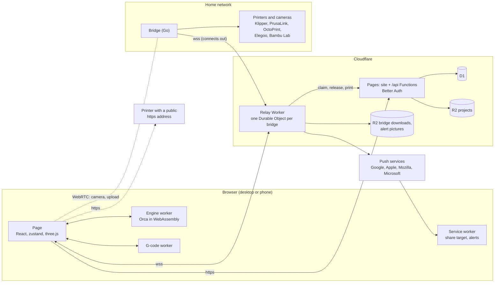

# Architecture

The whole system on one page. Each feature has its own page in
[architecture/](architecture/); [README.md](README.md) says which one to read for the
files you are changing.

## Goals and limits

- **A full slicer like desktop Orca, in the browser.** Whatever desktop Snapmaker Orca 2.4
  slices should slice here the same way, Bambu 3MF projects and colour mixes included.
- **Slicing runs only in the browser**, on desktops and phones. There is no server
  slicing and no separate phone app: one responsive site.
- **$0 a month**: Cloudflare's free tier only (Pages, D1, R2, Workers with Durable Objects).
- **Every printer brand the engine ships**, Snapmaker's loaded first.
- **Orca's own code and well-known libraries** rather than our own versions of them.
- **No telemetry. Open source**, AGPL-3.0 like the engine.

Why each of these, and what was turned down: [decisions.md](decisions.md).

## The pieces

| Piece | Where | What it does | Page |
|---|---|---|---|
| Page | `apps/web/src` | The whole UI: Prepare, Preview, Device tabs. State in zustand stores (`state/`), pure rules with tests in `lib/` | each feature |
| Engine worker | `engine/`, `public/engine/engine-worker.js` | Snapmaker Orca 2.4.0 or OrcaSlicer 2.4.2 compiled to WebAssembly, chosen per project, driven through a small API like desktop's GUI drives it | [engine](architecture/engine.md) |
| G-code worker | `src/engine/gcode-worker.ts` | Reads sliced G-code into lines for the Preview | [preview](architecture/preview.md) |
| Service worker | `public/sw.js` | Makes the site installable, receives files shared to it, shows alerts. Caches nothing, so a deploy's page and engine always match | [autosave](architecture/autosave.md), [alerts](architecture/print-alerts.md) |
| Pages Functions | `apps/web/functions` | `/api/*`: sign-in, presets, settings, printers, projects, print history, admin, the relay's calls | [accounts](architecture/accounts.md) |
| D1, R2 | `apps/web/migrations` | Accounts and everything they save; project files | [data](architecture/data.md) |
| Relay | `apps/device-relay` | Passes messages between browsers and bridges; alerts; bridge downloads | [relay](architecture/relay.md) |
| Bridge | `apps/device-bridge` | Small Go program on a home computer or the printer; connects out to the relay, talks to printers in their own protocols | [bridge](architecture/bridge.md) |
| CI | `.github/workflows` | Builds both engines, tests, deploys site, relay and bridge builds | [CI.md](CI.md) |
| `packages/printer` | | Printer helpers ported from the Android app. The site doesn't use them; only CI runs their tests | |

## Where data lives

| Store | Holds | Page |
|---|---|---|
| D1 (one database for production and every preview) | Accounts, user presets, settings, printers (keys encrypted), project index, print history, admin and bridge records | [data](architecture/data.md) |
| R2 `cloud-slicer-projects` | Project 3MFs and thumbnails, a new key per save | [projects](architecture/projects.md) |
| R2 `cloud-slicer-bridge` | Signed bridge builds and installers; alert pictures (deleted after a day) | [bridge](architecture/bridge.md) |
| Durable Object storage | Per bridge: key hashes, owner, alert subscriptions | [relay](architecture/relay.md) |
| Browser storage | Signed-out presets, settings and printers; per-device choices | [data](architecture/data.md) |
| The bridge's computer | Its secret key, printers and their API keys | [security](architecture/security.md) |

## Five main flows

1. **Slice.** The page sends the selected presets, the project's changes and the plate to
   the engine worker; Orca slices with every core; the G-code comes back with Orca's
   estimates and the plate pictures the page drew; the G-code worker reads it for the
   Preview. A change while slicing cancels it. [engine](architecture/engine.md),
   [preview](architecture/preview.md)
2. **Save a project.** The engine writes an Orca 3MF; signed in, it goes to R2 under a new
   key and D1 records it. AutoSave saves each change when things are quiet, and only one
   device edits a project at a time. [projects](architecture/projects.md),
   [autosave](architecture/autosave.md)
3. **Send to a printer.** The page zips the G-code and sends it over a direct WebRTC link
   to the bridge, or through the relay when that's blocked; the bridge unzips it into the
   printer. A printer with a public https address takes it directly.
   [send to printer](architecture/send-to-printer.md)
4. **Alert.** The bridge watches its printers with every browser closed; when something
   happens it tells the relay, which sends an encrypted Web Push to each browser that
   asked. [print alerts](architecture/print-alerts.md)
5. **Remember a print.** Every sent or downloaded G-code carries a tag line naming the
   project, plate and record; the bridge reads it when a print starts and ends and the
   relay passes that to the account. [print history](architecture/print-history.md)

## Features

Slicing in the browser: [engine](architecture/engine.md) ·
[presets](architecture/presets.md) · [settings](architecture/settings.md) ·
[projects](architecture/projects.md) · [autosave](architecture/autosave.md) ·
[plates](architecture/plates.md) · [prepare tools](architecture/prepare-tools.md) ·
[colour mixing](architecture/colour-mixing.md) · [preview](architecture/preview.md) ·
[calibration](architecture/calibration.md)

Accounts and storage: [accounts](architecture/accounts.md) · [data](architecture/data.md)

Printers: [device tab](architecture/device-tab.md) · [bridge](architecture/bridge.md) ·
[relay](architecture/relay.md) · [send to printer](architecture/send-to-printer.md) ·
[print alerts](architecture/print-alerts.md) · [print history](architecture/print-history.md)

Running it: [hosting](architecture/hosting.md) · [testing](architecture/testing.md) ·
[CI.md](CI.md) · [security](architecture/security.md) · [decisions](decisions.md)

## Still to come

- Desktop parity tools still missing (horizontal-only cut, no connectors; time per line type).
- The engine keeps a dropped big model's memory (load, clear, load again can run out on a phone).
- Painting kept through Simplify.
- Relay hardening: key rotation, end-to-end encryption ([SECURITY.md](../apps/device-relay/SECURITY.md)).
- OrcaSlicer 2.5: the proposal is to wait for its beta and then replace 2.4.2 with it; not decided yet ([decisions](decisions.md#engines)).
