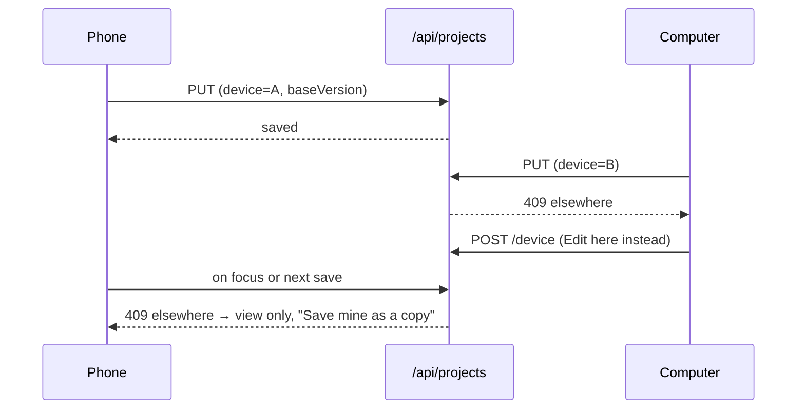

# AutoSave and Continue

> **Read this when** you change AutoSave timing, the Continue card, "one device edits at
> a time", or Share to Cloud Slicer. **Related:** [projects](projects.md),
> [data](data.md).

## What it does

AutoSave, for everyone, signed in or not: unsaved work is kept in this browser
(IndexedDB) a few seconds after each change, and the Continue card offers it back after a
crash or a closed tab ("Continue where you left off?"). It never leaves the browser, asks
nothing and has no switch. A project goes to Google Drive only when the person presses
Save. The top bar says "Saved in this browser" once the change is kept, "Saved" once it is
saved online.

Opening the app elsewhere offers to continue a project saved on another device; only one
device edits a project at a time. On Android, files shared from another app open here.

## Pieces

| Part | Where |
|---|---|
| Timer, queue, take-over, view only | `state/projects.ts` |
| Timing rules and Continue offer | `lib/autosave.ts` |
| Unsaved work kept in this browser | `lib/local-copy.ts` (idb-keyval) |
| Continue card, view-only notice | `components/ContinueCard.tsx`, shown as a [message card](../../apps/web/src/components/Notice.tsx) |
| Save status by the project name, the AutoSave note in the Project menu | `components/ProjectMenu.tsx` (`useSaveStatus`) |
| Device checks on the server | `functions/_lib/projects.ts` |
| Share target | `public/manifest.webmanifest` `share_target`, `public/sw.js`, `lib/share-target.ts` |

## How it flows

There is no polling: a device finds out on its next save or when its tab is focused.

## What it keeps

- D1 `projects.device` (a random id kept in the browser) and `device_name` ("phone") on
  every save. The `projects.draft` column and the `autosave` account setting are left
  from when AutoSave uploaded drafts to Drive; nothing reads or writes them now (D1
  columns are never dropped).
- Browser IndexedDB `cloud-slicer-unsaved` / `work` / `unsaved`: one copy of the unsaved
  work (3MF, name, online id and version, engine), dropped once it is saved.
- Browser: `cloud-slicer:open-project:v1` (the project open here when left),
  `cloud-slicer:continue-dismissed:v1` ("Not now", per project version).

## Rules

- Timing: kept 5 s after the last change, at most every 10 s (every minute for projects
  of 20 MB or more, since the engine takes a few seconds to write their 3MF), and when
  the tab is hidden. A slice's new preview isn't a change.
- Not while slicing or opening: the engine does one thing at a time and writing a big
  project's 3MF takes it many seconds (about 25 s for 67 MB), which the slice would wait
  behind at 0%. It keeps the work once the slice or opening is done (#288).
- One 3MF for both: the copy a slice keeps for reopening after a crash and AutoSave's are
  the same file when nothing changed in between (`saved3mf` with its edit count and
  settings, in `state/store.ts`), and a slice pressed while one is being written waits for
  that one instead of writing another. Its bar says "Saving a copy first" meanwhile.
- The Continue card offers the browser copy before anything from the account; Discard
  deletes it. It is dropped once the work is saved.
- Leaving with unsaved changes still asks (the browser's "Leave site?"): they are kept
  here, but not online.
- A device whose project was deleted elsewhere keeps its work, says so, and AutoSave keeps
  it in this browser.
- Continue offers, in order: the work kept in this browser, else the project open in this
  browser when it was left, else the newest project changed on another device in the last
  day. Once per visit.
- Share target: the service worker keeps shared files in the Cache API and opens
  `/?shared=1`, which opens or adds them.

## Why

- AutoSave used to upload the whole 3MF to Drive after every change (every 3 min for big
  ones): a 200 MB project re-uploaded 200 MB for one setting. Drive can only replace a
  whole file, so AutoSave now stays in the browser and Save is the only upload
  (2026-11-07). The cost: work started on one device reaches another only after Save.
- "Discard only if not open elsewhere" was turned down: without presence or polling we
  can't tell open from asleep. See [decisions.md](../decisions.md#projects-and-autosave).

## Tests

`accounts.mjs` (kept in this browser and nothing in Drive, Continue after a reload and on
another device, view only, Share to Cloud Slicer); unit test `autosave.test.ts`.

## Open

- Saving only what changed (a small settings file beside the 3MF) would make Save of a big
  project fast too; not built.
