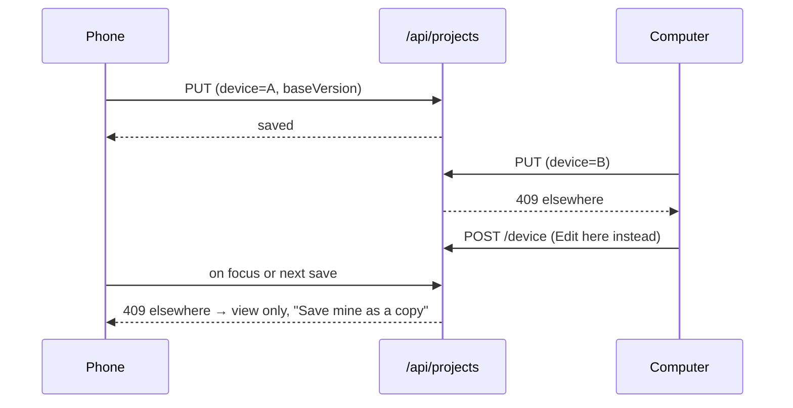

# AutoSave, drafts and Continue

> **Read this when** you change AutoSave timing, drafts, the Continue card, "one device
> edits at a time", or Share to Cloud Slicer. **Related:** [projects](projects.md),
> [data](data.md).

## What it does

Signed in, work saves itself like Word: new work is a draft, the first Save names it,
then each change saves when things are quiet. Opening the app elsewhere offers to
continue; only one device edits a project at a time. On Android, files shared from
another app open here.

## Pieces

| Part | Where |
|---|---|
| Timer, queue, take-over, view only | `state/projects.ts` |
| Timing rules and Continue offer | `lib/autosave.ts` |
| Continue card, view-only notice | `components/ContinueCard.tsx`, shown as a [message card](../../apps/web/src/components/Notice.tsx) |
| Drafts and device checks on the server | `functions/_lib/projects.ts` |
| Share target | `public/manifest.webmanifest` `share_target`, `public/sw.js`, `lib/share-target.ts` |

## How it flows

There is no polling: a device finds out on its next save or when its tab is focused.

## What it keeps

- D1 `projects.draft = 1` for drafts; `device` (a random id kept in the browser) and
  `device_name` ("phone") on every save.
- Account setting `autosave` (the on/off switch).
- Browser: `cloud-slicer:open-project:v1` (the project open here when left),
  `cloud-slicer:continue-dismissed:v1` ("Not now", per project version).

## Rules

- Timing: save 5 s after the last change, at most every 30 s (every 3 min for projects of
  5 MB or more, since each save uploads the whole 3MF), and when the tab is hidden;
  thumbnail at most every 10 min.
- One draft per device, at most 3 per person (oldest go first). Drafts don't count
  toward the 200 projects but do count toward storage.
- A device whose draft was deleted elsewhere keeps its work, says so and saves a new draft.
- Continue offers, in order: the project open in this browser when it was left, else the
  draft, else the newest project changed on another device in the last day. Once per visit.
- Share target: the service worker keeps shared files in the Cache API and opens
  `/?shared=1`, which opens or adds them.

## Why

- One draft per person made two devices delete each other's work; one per device fixed it.
- "Discard only if not open elsewhere" was turned down: without presence or polling we
  can't tell open from asleep. See [decisions.md](../decisions.md#projects-and-autosave).

## Tests

`accounts.mjs` (drafts, Continue on another device, view only, Share to Cloud Slicer);
unit test `autosave.test.ts`.

## Open

- Signed out, nothing autosaves.
