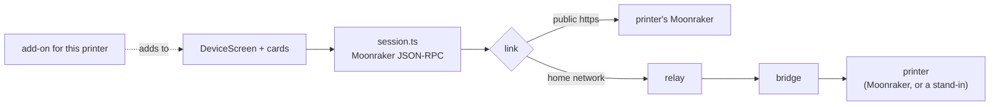

# Device tab

> **Read this when** you change the Device tab's screen: cards, add-ons for a printer
> family, the layout and Arrange, cameras and page cards, tool heads, the print dialog,
> filament slots, skip objects. **How it reaches the printer:** [bridge](bridge.md),
> [relay](relay.md). **Related:** [send to printer](send-to-printer.md),
> [print alerts](print-alerts.md).

## What it does

One screen per printer: status, temperatures, motion, console, files, upload and print,
cameras, alerts, skip objects mid-print, and extras for printers that have them (U1 tool
heads, Bambu AMS slots). Works for any Klipper (Moonraker) printer, and for Prusa,
OctoPrint, Elegoo Centauri Carbon and Bambu Lab printers through the bridge.

## Pieces

| Part | Where |
|---|---|
| State: saved printers, live connection, send hand-off | `src/state/device.ts` |
| One live connection: Moonraker JSON-RPC, subscriptions, commands | `device/session.ts`, `status.ts`, `commands.ts` |
| How it reaches the printer | `device/link/direct.ts`, `link/bridge.ts` |
| Add-ons per printer family | `device/addons/` (`u1`, `prusa`, `octoprint`, `elegoo`, `bambu`), `types.ts` |
| Kinds of printer, "Which printers work?" | `device/brands.ts`, `ui/WorksWith.tsx` |
| Tool heads, filament slots, "From printer" | `device/heads.ts`, `slots.ts`, `lib/filament-sync.ts`, `components/FilamentSync.tsx` |
| Cameras | `device/camera.ts`, `direct-camera.ts`, `webrtc.ts`, `ui/CameraCard.tsx` |
| Page cards (a printer's own page, e.g. its remote screen) | `device/printer-page.ts`, `ui/PrinterPage.tsx`, relay `page-shell.ts` |
| Layout and Arrange | `device/layout.ts`, `ui/Arrange.tsx`, `ui/DeviceScreen.tsx` |
| Skip objects | `device/objects.ts`, `ui/SkipObjects.tsx` |
| Error words (U1, Bambu) | `addons/u1-errors.*`, `addons/bambu-errors.*` (rebuilt by `scripts/u1-errors.mjs`, `bambu-errors.mjs`) |
| Cards | `device/ui/*Card.tsx`, `HeadBed.tsx`, `HeadFace.tsx`, `PrintDialog.tsx`, `ManageDialog.tsx`, `PrinterEditor.tsx`, `BridgeSetup.tsx` |

## How it flows

The page always speaks Moonraker. For non-Klipper printers the bridge runs a stand-in
Moonraker and also passes the printer's raw report (for example a `bambu` object) beside
the Klipper objects; the add-on reads that raw data itself.

## What it keeps

Saved printers and bridges in the account store (`devices`), per-printer layout as the
setting `device-layout.<printer id>`, per-device conveniences in browser storage
([data](data.md#browser-storage-per-device-cloud-slicer)).

## Rules

- **Two layers, one screen.** The generic Klipper screen works for every printer; an
  add-on only adds to the same cards (tool heads, print dialog, chamber). Users never see
  a "special" section.
- Add-ons say what a printer can't do (`noCommands`, `noCamera`) and the screen leaves
  those controls out.
- Generic over printer-specific: filament "loaded" comes from Klipper's filament sensors
  matched by name, not a U1-only flag.
- A folded camera or page card streams and loads nothing.
- Each printer has its own layout; a new printer starts from the default; removing a
  printer removes its layout.
- The page is cross-origin isolated (COEP `require-corp`): a camera image from another
  origin needs CORS or a credentialless frame.
- The app never starts a print by itself. "Upload only" sends; "Upload and print" starts.

## Why

- Klipper first, everything else through a stand-in, so one screen serves every brand.
- Raw brand data beside the Klipper objects (the "A/P1" decision, 2026-10-25): the bridge
  stays a pipe for data; the site reads it.
- Layout per printer (changed from one shared layout on 2026-10-25).
  See [decisions.md](../decisions.md#device-tab).

## Tests

`device-smoke.mjs`, `device-arrange.mjs`, `device-pages.mjs`, `device-klipper.mjs`
(real Klipper, nightly), `device-prusa.mjs`, `device-octoprint.mjs`,
`device-elegoo.mjs`, `device-bambu.mjs`, `sync-filaments.mjs`; unit tests in
`src/device/`.

## Open

- Bambu Lab printers are tested only against a pretend printer. X1, H2 and P2S cameras
  (RTSP) aren't shown.
- The same camera in two camera cards isn't possible (parked).
