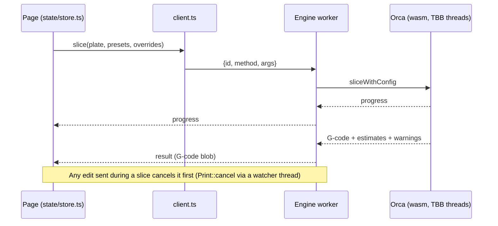

# Engine

> **Read this when** you change anything under `engine/`, the engine worker, or how the
> page talks to it. **Build commands and the full API file list:**
> [engine/README.md](../../engine/README.md). **Related:** [presets](presets.md),
> [preview](preview.md), [CI.md](../CI.md#published-engines).

## What it does

Slices in the browser with the same code as desktop: Orca's `libslic3r` compiled to
WebAssembly. Two engines ship, and each project picks one: Snapmaker Orca 2.4.0
(`engine/orcaslicer`, the default) or OrcaSlicer 2.4.2 (`engine/orcaslicer-upstream`).

## Pieces

| Part | Where |
|---|---|
| The two Orca sources, pinned submodules, never edited in place | `engine/orcaslicer`, `engine/orcaslicer-upstream` |
| Our API over Orca, one file per area (presets, model, slice, each tool) | `engine/src/*_api.cpp` |
| Browser-only fixes as patch files, applied to copies at build time | `engine/patches/` (`snapmaker/`, `orca/` for one engine only) |
| Stand-ins for what a browser lacks | `engine/compat/` |
| Memory set-up (mimalloc, arena size) | `engine/src/memory.cpp` |
| Presets bundling, settings layout, bed meshes | `engine/scripts/` |
| Engine worker (loads wasm, presets, answers calls) | `apps/web/public/engine/engine-worker.js` |
| Client the page calls, message types | `apps/web/src/engine/client.ts`, `protocol.ts` |
| Which engine a project uses, switching | `apps/web/src/lib/engines.ts`, `engine-switch.ts` |
| Node CLI and engine tests | `engine/node/` |

## How it flows

- Everything crossing the worker boundary is in Orca's own words: preset names, option
  keys, serialized values, JSON.
- Plate thumbnails: the engine has no OpenGL, so the page draws each plate and hands the
  pictures to Orca's own G-code export.
- If the engine crashes after start, a new one starts and reopens the project
  (from its 3MF, or a copy saved before slicing if it was edited).
- Files the worker loads carry `?v=<engine build hash>`, so a cached older engine is
  never mixed with a newer page.

## What it keeps

Nothing of its own between visits. The engine's file system holds the bundled presets,
the user's presets (written before presets load) and fonts for the Text tool.

## Rules

- Each tool is one `engine/src/<tool>_api.cpp`: JSON in, JSON out, added to the
  `add_executable` line in `engine/CMakeLists.txt`, with a Node test in
  `engine/node/engine.test.mjs` and a browser test.
- Anything Orca starts on its own thread and waits for (mcut did) hangs in a browser but
  works in Node: run it in place with a patch, and always run the browser test.
- What only one engine has compiles only for it (`ENGINE_HAS_MIXING`,
  `ENGINE_HAS_FLOW_VARIANTS`); differing calls sit under `#if ENGINE_UPSTREAM`.
- A model object's bounding box goes stale after an instance moves: call
  `invalidate_bounding_box()` before `ensure_on_bed()`.
- Never call `ModelVolume::get_extruders` for model info (it rebuilds paint and crashed
  CI); use `get_extruders_from_multi_material_painting()`.

## Why

- **Our own small API over `libslic3r`, not the Android app's glue**: it drives Orca the
  way desktop's GUI does (`PresetBundle`, `Model`, `Print`, `GCodeProcessor`), so results
  match desktop.
- **Every core, like desktop**: TBB on Emscripten threads with mimalloc. Plain malloc had
  one lock and made threads useless; mimalloc's default arenas doubled memory, so
  `memory.cpp` sends TBB's allocator to malloc and sets 128 MB arenas.
- **Patches 0006 and 0007** keep big slices inside a phone's memory: G-code results are
  moved rather than copied, and only the last move is kept (desktop keeps every move for
  its preview; we parse the G-code instead).
- **No wasm64**: Safari lacks it, phones kill tabs below 4 GB anyway, and it is slower.
- More in [decisions.md](../decisions.md#engines).

## Tests

`engine/node/engine.test.mjs` (both engines, in CI `engine-tests`),
`engine/klipper-check/check.sh` (Klipper accepts the G-code), browser tests
`smoke.mjs`, `cancel.mjs`, `restart.mjs`, `startup-matrix.mjs`, `engines.mjs`,
`engine-switch.mjs`.

## Open

- A dropped big model's memory isn't freed: load a 1.1M-triangle model, clear, load again,
  simplify, and the engine runs out. Cancel in the Simplify question works round it by
  starting a fresh engine.
- No STEP reader in the default build (no OpenCASCADE), no SLA hollowing.
