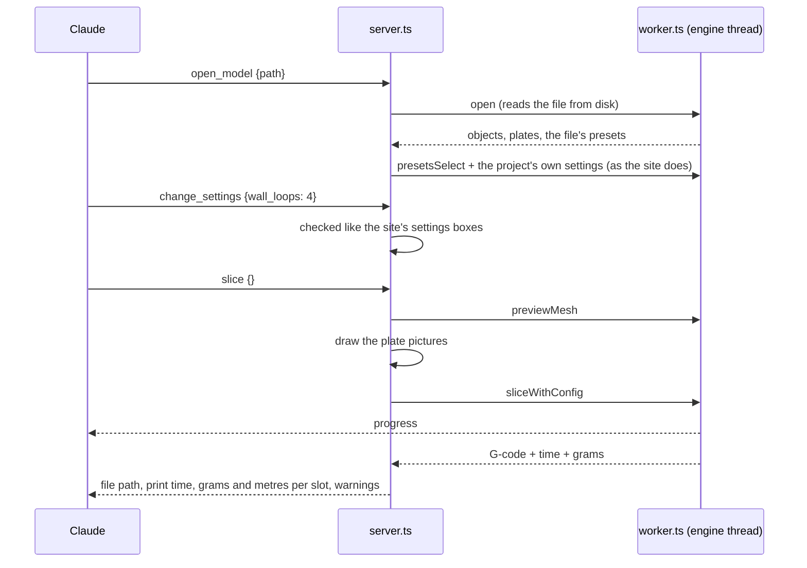
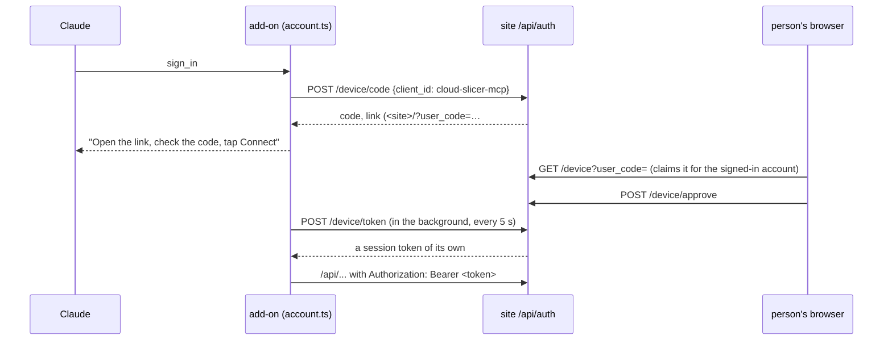

# Slicing from Claude (MCP server)

> **Read this when** you change `apps/mcp/`, or `engine/node/engine.mjs` (the MCP server
> shares it with the CLI and the engine tests). **Install and tool list:**
> [apps/mcp/README.md](../../apps/mcp/README.md). **Related:** [engine](engine.md),
> [presets](presets.md), [settings](settings.md), [projects](projects.md).

## What it does

A small program on the person's own computer that lets Claude (Claude Code, Claude
Desktop) slice: open a model, choose presets and filament colours, pick which filament
prints each object, change settings (for the plate or one object), move or copy objects
across plates, look at the plate, slice one plate or all, and read the print time and
filament use. It uses the same engines and presets
as the site, running under Node instead of a browser, so a slice from Claude matches a
slice on the site. Slicing never leaves the computer. Signing in is optional: it
connects the person's Cloud Slicer account (see Signing in) for what needs it; nothing
else goes over the internet.

## Pieces

| Part | Where |
|---|---|
| The tools Claude sees (official MCP TypeScript SDK, over stdin/stdout) | `apps/mcp/src/server.ts` |
| One engine, one open project, the chosen presets and changed settings | `apps/mcp/src/slicer.ts` |
| The engine on its own thread, like the site's engine worker | `apps/mcp/src/worker.ts`, `engine-client.ts` |
| Plate pictures without a GPU | `apps/mcp/src/picture.ts` |
| Pictures of the sliced toolpaths (`sliced_picture`): the site's G-code parser (`lib/gcode.ts`) and Preview colours (`lib/preview-colours.ts`), each extrusion drawn as a lit bead; the legend comes back as text beside the picture | `apps/mcp/src/toolpaths.ts` |
| Signing in to the person's account, and calls to the site's `/api` as them | `apps/mcp/src/account.ts` |
| Their online projects: list, open, save, print history (with the site's `account/drive.ts`, `lib/prints.ts`) | `apps/mcp/src/projects.ts` |
| The site's approval window for that sign-in | `apps/web/src/account/LinkProgramDialog.tsx` |
| Their printers: status, files, send, the Device tab's controls | `apps/mcp/src/printers.ts`, with the site's `device/session.ts`, `link/bridge.ts`, `link/direct.ts`, add-ons, `device/print-plan.ts`, `device/saved.ts`, `device/commands.ts` |
| Loading the engine, presets, brands, opening and slicing (shared with `slice.mjs` and the engine tests) | `engine/node/engine.mjs` |
| The site's own rules it reuses | `lib/project-import.ts` (a 3MF's own settings), `lib/presets.ts` (matching filaments), `lib/option-check.ts` (checking typed values), `lib/thumbnail.ts` (picture camera and colours), `lib/format.ts` |
| Build: one bundle plus both engines and their presets | `apps/mcp/build.mjs` → `apps/mcp/dist/` |
| Install files: Claude Desktop extension and `npx` package, on the `mcp` release | `apps/mcp/pack.mjs` → `apps/mcp/release/`; CI job `mcp` publishes on main |

## How it flows

- Everything is in Orca's own words: preset names, option keys, values as Orca writes them.
- A 3MF made for a printer the presets have opens with its presets, filaments and own
  settings, like the site. One made for another printer stays on the current printer
  with its filaments matched by material, and Claude is told; the site asks the person
  instead.
- Brands beyond Snapmaker load when a printer of that brand is chosen, like the site.
- The engine runs on its own thread so the server keeps answering (and passes progress
  on) while a slice runs. Calls run one at a time. If the engine stops (out of memory),
  the next call starts a fresh one and says the model must be opened again.

## Installing

Two files on the GitHub release `mcp`, rebuilt on every push to main with the same links,
so a link given out keeps working and always gives the newest: `cloud-slicer.mcpb` (a
Claude Desktop extension: open it, Install; it runs on the Node that Claude Desktop
ships) and `cloud-slicer-mcp.tgz` (`npx -y <link>` for Claude Code and other MCP apps).
Both carry the engines inside (about 11 MB each), so they never depend on CI's
`engine-builds`, which keeps only the newest 15. No npm account, no hosting: $0.
Each build has its own version, `0.1.<CI run number>` (`MCP_VERSION`, read by `build.mjs`
and `pack.mjs`): Claude Desktop installs a downloaded extension over the old one only
when its version is newer. To update, the person downloads it again and opens it.

On the site, **Use with an AI app** (`apps/web/src/components/AiAppsDialog.tsx`) shows
how: in the account menu, and in the Project menu too, since the add-on needs no account
and the account menu has no items before signing in. Two choices: **Claude Desktop** (the
`.mcpb` download, open it, Install) and **Other chat apps** (the `mcpServers` settings
with `npx` and the `.tgz` link, with Copy). Chat apps only: coding apps work with the same
line but aren't offered (the README has it). The same window on a phone, which can't run
it but can read how. Named for any AI app, not Claude, because MCP is an open standard.

## Signing in

Better Auth's device authorization plugin (RFC 8628, the "enter this code on your TV"
sign-in), set up in `functions/_lib/auth.ts`:

- The link opens the site's **Connect an AI app** window: signed out, it asks to sign in
  with Google first; signed in, it shows the account's email and the code, and Connect /
  Don't connect. The setup wizard waits while it is open. A bare `#link` asks for the code.
- No password or Google sign-in passes through the add-on or the AI app. The token is an
  ordinary session (the `bearer` plugin), so it ends on Sign out, Block or Delete like
  any other, and lasts as long as a browser session.
- Only `PROGRAM_CLIENTS` (`cloud-slicer-mcp`) may ask for a code. Codes last 10 minutes;
  expired ones are deleted when the next is asked for, and at most 200 may wait at once
  (`deviceCode` table, [data](data.md)).
- Tools: `sign_in` (the link and code), `account` (who, or still waiting, or why it
  failed), `sign_out` (ends the session on the site too).
- **Their own presets**: signed in, the add-on fetches `/api/presets` (at most once a
  minute while tools are used, and at once after signing in or out) and loads them the
  way the site does (`presetForEngine` / `expandPending` from `lib/preset-engines.ts`,
  then `writeUserPresets` in `engine/node/engine.mjs`, desktop Orca's user preset
  files). A printer of their own loads its base printer's brand first. `find_printers`
  and `list_presets` mark them `yours`. Offline it keeps the last ones it had.
- The site ending the session (Sign out there, Block, Delete) shows on the next call:
  the add-on forgets the sign-in and their presets.

## Their printers

Signed in, the add-on reaches the account's printers (`/api/devices`, each one's key from
`/api/devices/<id>/secret`) the way the Device tab does, with the same code: a printer
behind a bridge through the relay with the site's ticket (`/api/relay/ticket`), one
reached directly over its own address. Node has no WebRTC, so uploads always stream
through the relay (and over plain `fetch` to a direct printer). A connection opens when
a tool needs it and closes a minute after the last use: no streaming in the background.

| Tool | What it does | Asks first |
|---|---|---|
| `printers` | The account's printers | |
| `printer_status` | Printing or not, progress, temperatures, each head's filament, errors | |
| `printer_files` | Files on the printer, newest first | |
| `printer_camera` | Still pictures, one per camera (at most 4; or one named camera): Moonraker's cameras, else the add-on's (the U1's own, woken with `camera.start_monitor` first); through the bridge as `bridge.snapshot`. No video | |
| `send_to_printer` | Uploads the newest slice (the `.gcode.3mf` when the printer takes one) or a file; with `print`, starts it with the Send window's own plan (`device/print-plan.ts`: slot per filament, the printer's options, checks, start calls) | `print` only |
| `printer_control` | print a file on it, pause, resume, stop, skip object, home, move, extrude, heat, U1 load / unload / pick / park a head | yes |
| `printer_control` | motors off, heat off, fans, light, speed and flow %, a U1 head's filament type and colour | no |

- **Asking** (`asker` in `server.ts`) is MCP elicitation where the app has it: one Accept /
  Decline message on screen, every time, before anything is sent. Decline does nothing.
  Where it doesn't (Claude on a phone, reaching Claude Desktop), the first call does
  nothing and answers with the question and a 6-digit code: Claude asks in the chat, and
  only a second call with the same action and arguments plus that code goes ahead. A code
  works once, for 5 minutes, only for the action it was given for (owner's pick,
  2026-11-12; the phone had no way to say yes before).
- **Slow commands** (a U1 homes for about a minute, loading filament longer): a control
  waits at most 20 s (`WAIT_MS` in `printers.ts`), then answers that it was sent and is
  still running; `printer_status` lists what the add-on `sent` lately with each result
  (running, done, failed with Klipper's reason, or unknown when the connection dropped
  before the printer answered), plus `homedAxes`, temperatures and filaments. The
  connection stays open while a command runs. The list lives in the add-on (5 newest,
  30 minutes), so it starts empty after the AI app restarts it. An AI
  app gives up on a tool after about a minute and drops the add-on (seen 2026-11-12).
- Refused before asking: a print while the printer prints or isn't ready, a filament with
  no head or slot it can print from (the Send window's checks), moving while it prints, a
  printer whose add-on takes no commands (Bambu Lab: status, files and prints only).

## Their online projects

Signed in, the add-on reaches the person's online projects (the site's Online projects
window, [projects](projects.md)) the way the page does. The files stay in their Google
Drive: the add-on asks the site for a short Drive key (`POST /api/drive/token`) and
downloads and uploads straight to Google with the site's own `account/drive.ts`
(`setDriveKeySource` swaps the page's sign-in for the add-on's), so a project never
passes through Cloud Slicer. The site keeps the list, versions and print history.

| Tool | What it does | Asks first |
|---|---|---|
| `online_projects` | The list, newest first: when changed, plates, printed plates, which device is editing it | |
| `open_online_project` | Takes the project over (`POST /api/projects/<id>/device`, device `AI app`, an id made from this computer) and opens its 3MF from Drive; a site tab with it open only views it from then on, as when it opens on another computer | |
| `save_online_project` | Saves over the project it came from (`baseVersion`: refused with "changed or opened elsewhere" when the site has a newer one) or, with `asNew` or for a file from this computer, as a new one; then the list picture | yes, every time (it writes to their Drive) |
| `project_history` | The project's print history, newest first | |

- **Print history**: a slice of an open online project's plate keeps that plate's
  fingerprint (`plateFingerprint`, `summarize`, `fingerprintOf` from `lib/prints.ts`).
  When `send_to_printer` sends that slice, the G-code goes with the tag line
  (`withPrintTag`; the file on this computer stays as sliced; a `.gcode.3mf` goes as it
  is, as from the site) and the send makes a record (`uploaded`, or `sent` when it
  started), as the page's `onFileSent` does. The bridge and the Device tab then follow
  the print and write how it ended. A send of any other file makes no record.
- `open_model` (not `add`) leaves the online project: what is open is then a file from
  this computer.
- `CLOUD_SLICER_GOOGLE` points the Drive calls at a stand-in (tests only, like
  `CLOUD_SLICER_SITE`).

## Limits

Hidden guards, so a program stuck in a loop can't use up the free tier. They live on the
site and the relay, not in the add-on (anyone can change a program):

- **Sign-in codes**: only the add-on's client id; at most 200 waiting at once.
- **Relay messages** with a `prog` ticket (the site marks tickets it gives an add-on's
  token; the add-on keeps each one for its hour): 10,000 per account per bridge a day
  ([relay](relay.md#free-tier-budget)); a status reading is a few, a 40 MB zipped upload
  about 160.
- **Site calls**: presets at most once a minute; a printer's connection is reused for a
  minute, then closed. Over a limit the person reads why, and the Device tab still works.
- A token (no `Origin`, `Authorization: Bearer`) passes the site's same-origin check:
  another site's page can't send that header here.

## What it keeps

The sign-in, if any: the site and its token (plus name and email for showing) in
`<config>/cloud-slicer/account.json` (`%APPDATA%`, `~/Library/Application Support` or
`~/.config`), readable only by the computer's user. A token for another site
(`CLOUD_SLICER_SITE`, for tests and previews) is ignored. A model Claude made in the chat (`open_model` with `content`
and `name`: text for an ASCII STL or OBJ, base64 for a binary STL or 3MF; AI apps hand an
add-on no files of their own) is written to `~/Cloud Slicer/From the chat/` (never over
another file, the name kept inside that folder) so the engine can read it and the person
can find it; its G-code goes beside it. Nothing else between runs. The G-code (and a `.gcode.3mf` for printers that take one) goes
where Claude says, or beside the model, named by the printer's file name format.

## Rules

- **Reuse, don't copy**: engine calls go through `engine/node/engine.mjs`; preset and
  settings rules are the site's own `lib/` helpers, bundled in by esbuild. A rule the
  MCP needs that the site also has goes in `lib/` and both use it.
- **No new rules per setting**: values are checked from the engine's option descriptions
  (`checkOptionValue`, enum choices), never a list of our own.
- **The plate picture follows the site's**: `picture.ts` uses `thumbnailCamera` and
  `partColour` from `lib/thumbnail.ts` and the same lighting numbers as its shader. A
  change to one changes the other.
- **Never start a print without asking**: "Upload and print", and every control that
  heats, moves, starts, resumes or stops, asks the person every time: on screen, or in
  the chat with a one-time code.
- **The Device tab's code, not a copy**: printer code the add-on needs moves out of React
  and the page state into plain modules (`device/print-plan.ts`, `device/saved.ts`) that
  both use.
- Tool names and descriptions say what happens in plain words; errors say what to do.

## Why

- **Claude on the phone** reaches it through Claude Desktop while the computer is on
  (seen by the owner 2026-11-12); the window says so, and calls it a Claude Desktop
  extension, not an MCP add-on (the Other chat apps steps still say MCP server, as those
  apps do).
- **No online add-on** for ChatGPT, Gemini or Claude on the web (2026-11-05):
  they only take add-ons at an internet address, and we don't slice on servers, so it
  would have to hand the slice to the person's open tab: too complicated for what it gives.
- **On the person's computer, not ours**: slicing on a server is turned down (cost), and
  a local program costs nothing and works offline. An online MCP on Cloudflare can't
  slice, so it would only cover account things (later).
- **Its own engine thread**: `sliceWithConfig` blocks the thread it runs on; on the
  server's thread Claude would see no progress and no answers for the whole slice.
- **Pictures drawn on the processor**: Node has no WebGL that three.js still supports
  (headless-gl is WebGL 1 only). Drawing the site's camera, colours and lighting
  triangle by triangle gives the same picture: on the colour Benchy 64 of 90,000 pixels
  differ, all on edges.
- **Both engines in one build**: projects pick an engine on the site, so Claude can too.

## Tests

`apps/mcp/test/mcp.test.mjs` starts the built server the way Claude does (the SDK's own
client over stdin/stdout): open an STL and slice it with pictures and progress, settings
by key (refused, set to nearest, taken back), another brand (Prusa MK4, PETG), a 3MF
project's own presets, move/copies/arrange then save and reopen, filament and settings
per object with the plate picture as an image, every plate at once, OrcaSlicer 2.5.0,
and plain errors. The site's window: `apps/web/test/ai-apps.mjs` (Project menu, both
choices, links, Copy, phone) and the account menu's button in `accounts.mjs`. Signing
in: `accounts.mjs` runs `account.ts` against the real site functions (wrangler, local D1):
approve, turn down, the saved file, expired codes cleared, sign out ends the token, and
the Connect an AI app window in Chromium on desktop and phone. `apps/mcp/test/account.test.mjs`
runs the add-on against a stand-in site: their presets (a Prusa-based printer of their
own too) chosen and their settings in the slice config, fetched once, and gone when the
site ends the session. `apps/mcp/test/printers.test.mjs` uses pretend printers only: a
pretend U1 behind the real bridge (Go) and a local relay, and a pretend Klipper printer
reached directly. Status, upload only, upload and print (no sends nothing, yes starts it
the U1 way, busy is refused), the controls (which ask, which don't, a no sends nothing),
and an app that can't show a popup (asks in the chat: a made-up, used or other action's code only asks again). The CI job `mcp` sets up Go and the relay for it. CI job `mcp` builds it with both engines, type-checks, runs the test,
packs the install files and starts the packed one.

## Open

- Not tried on a real printer yet (rule: pretend printers in tests; "Upload only" is fine
  on a real one).
- Site-only extras (per-plate settings, colour mixes chosen on the site) come only from
  a 3MF made there.
