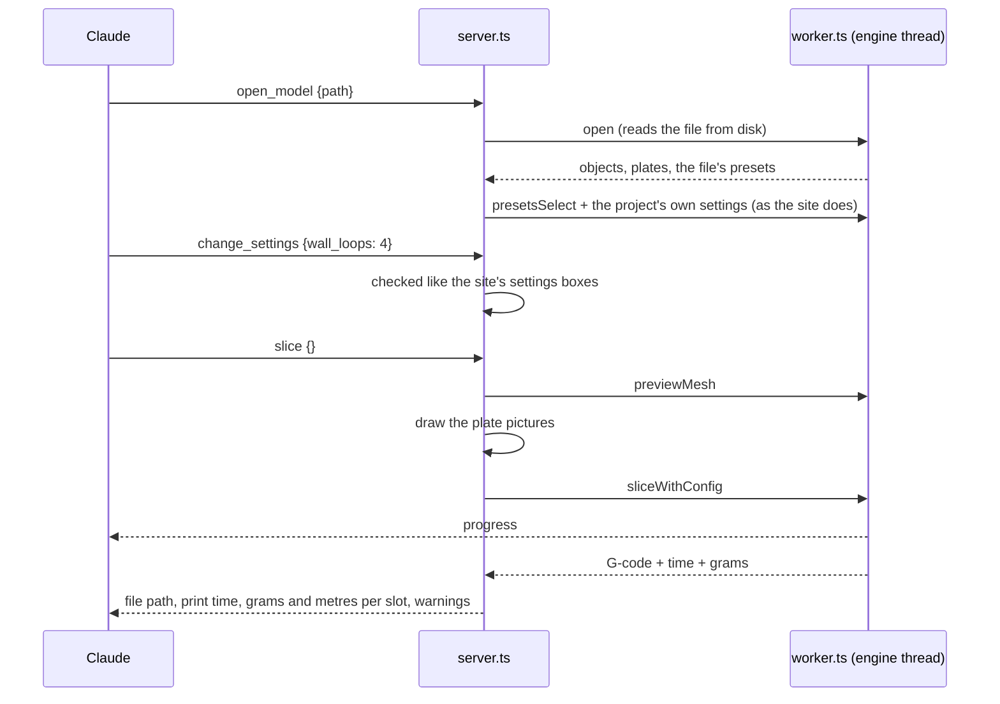

# Slicing from Claude (MCP server)

> **Read this when** you change `apps/mcp/`, or `engine/node/engine.mjs` (the MCP server
> shares it with the CLI and the engine tests). **Install and tool list:**
> [apps/mcp/README.md](../../apps/mcp/README.md). **Related:** [engine](engine.md),
> [presets](presets.md), [settings](settings.md), [projects](projects.md).

## What it does

A small program on the person's own computer that lets Claude (Claude Code, Claude
Desktop) slice: open a model, choose presets and filament colours, pick which filament
prints each object, change settings (for the plate or one object), move or copy objects
across plates, look at the plate, slice one plate or all, and read the print time and
filament use. It uses the same engines and presets
as the site, running under Node instead of a browser, so a slice from Claude matches a
slice on the site. It talks to nothing on the internet: no sign-in, no relay, no
Google Drive (those come later, with their own limits; see Open).

## Pieces

| Part | Where |
|---|---|
| The tools Claude sees (official MCP TypeScript SDK, over stdin/stdout) | `apps/mcp/src/server.ts` |
| One engine, one open project, the chosen presets and changed settings | `apps/mcp/src/slicer.ts` |
| The engine on its own thread, like the site's engine worker | `apps/mcp/src/worker.ts`, `engine-client.ts` |
| Plate pictures without a GPU | `apps/mcp/src/picture.ts` |
| Loading the engine, presets, brands, opening and slicing (shared with `slice.mjs` and the engine tests) | `engine/node/engine.mjs` |
| The site's own rules it reuses | `lib/project-import.ts` (a 3MF's own settings), `lib/presets.ts` (matching filaments), `lib/option-check.ts` (checking typed values), `lib/thumbnail.ts` (picture camera and colours), `lib/format.ts` |
| Build: one bundle plus both engines and their presets | `apps/mcp/build.mjs` → `apps/mcp/dist/` |
| Install files: Claude Desktop extension and `npx` package, on the `mcp` release | `apps/mcp/pack.mjs` → `apps/mcp/release/`; CI job `mcp` publishes on main |

## How it flows

- Everything is in Orca's own words: preset names, option keys, values as Orca writes them.
- A 3MF made for a printer the presets have opens with its presets, filaments and own
  settings, like the site. One made for another printer stays on the current printer
  with its filaments matched by material, and Claude is told; the site asks the person
  instead.
- Brands beyond Snapmaker load when a printer of that brand is chosen, like the site.
- The engine runs on its own thread so the server keeps answering (and passes progress
  on) while a slice runs. Calls run one at a time. If the engine stops (out of memory),
  the next call starts a fresh one and says the model must be opened again.

## Installing

Two files on the GitHub release `mcp`, rebuilt on every push to main with the same links,
so a link given out keeps working and always gives the newest: `cloud-slicer.mcpb` (a
Claude Desktop extension: open it, Install; it runs on the Node that Claude Desktop
ships) and `cloud-slicer-mcp.tgz` (`npx -y <link>` for Claude Code and other MCP apps).
Both carry the engines inside (about 11 MB each), so they never depend on CI's
`engine-builds`, which keeps only the newest 15. No npm account, no hosting: $0.

## What it keeps

Nothing between runs. The G-code (and a `.gcode.3mf` for printers that take one) goes
where Claude says, or beside the model, named by the printer's file name format.

## Rules

- **Reuse, don't copy**: engine calls go through `engine/node/engine.mjs`; preset and
  settings rules are the site's own `lib/` helpers, bundled in by esbuild. A rule the
  MCP needs that the site also has goes in `lib/` and both use it.
- **No new rules per setting**: values are checked from the engine's option descriptions
  (`checkOptionValue`, enum choices), never a list of our own.
- **The plate picture follows the site's**: `picture.ts` uses `thumbnailCamera` and
  `partColour` from `lib/thumbnail.ts` and the same lighting numbers as its shader. A
  change to one changes the other.
- **Never start a print without asking**: sending to a printer is not in this version;
  when it comes, "Upload and print" asks the person on screen every time.
- Tool names and descriptions say what happens in plain words; errors say what to do.

## Why

- **On the person's computer, not ours**: slicing on a server is turned down (cost), and
  a local program costs nothing and works offline. An online MCP on Cloudflare can't
  slice, so it would only cover account things (later).
- **Its own engine thread**: `sliceWithConfig` blocks the thread it runs on; on the
  server's thread Claude would see no progress and no answers for the whole slice.
- **Pictures drawn on the processor**: Node has no WebGL that three.js still supports
  (headless-gl is WebGL 1 only). Drawing the site's camera, colours and lighting
  triangle by triangle gives the same picture: on the colour Benchy 64 of 90,000 pixels
  differ, all on edges.
- **Both engines in one build**: projects pick an engine on the site, so Claude can too.

## Tests

`apps/mcp/test/mcp.test.mjs` starts the built server the way Claude does (the SDK's own
client over stdin/stdout): open an STL and slice it with pictures and progress, settings
by key (refused, set to nearest, taken back), another brand (Prusa MK4, PETG), a 3MF
project's own presets, move/copies/arrange then save and reopen, filament and settings
per object with the plate picture as an image, every plate at once, OrcaSlicer 2.4.2,
and plain errors. CI job `mcp` builds it with both engines, type-checks, runs the test,
packs the install files and starts the packed one.

## Open

- **"Use with Claude" on the site**: how to install, from the account menu (sketch first).
- **Second step**: sign-in (own presets and printers), printer status, "Upload only" and
  "Upload and print" through the relay, with limits on the site and relay per account
  so a program can't use up the free tier.
- **Online MCP** on Cloudflare for claude.ai and the phone (account things only).
- Site-only extras (per-plate settings, colour mixes chosen on the site) come only from
  a 3MF made there.
