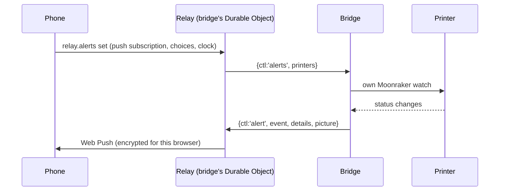

# Print alerts

> **Read this when** you change alerts: which moments, their words, Web Push, the
> Alerts card, or how the bridge watches prints. **Related:** [relay](relay.md),
> [bridge](bridge.md), [print history](print-history.md) (same watch).

## What it does

Phone or computer notifications for a printer, even with every tab closed: failed,
paused or filament out, error and finished by default; started, first and third layer,
percentages, almost done, still printing, resumed, bed cooled and bridge offline on
request. Each says where the print stands (progress, layer, time left in the phone's own
time zone, filament used) and key ones carry a camera picture.

## Pieces

| Part | Where |
|---|---|
| Rules: when an event fires | `apps/web/src/device/alerts.ts` and bridge `alerts.go` (same cases: `testdata/alert-cases.json`) |
| What an alert says | `device/alert-text.ts` (details: `testdata/alert-details-cases.json`) |
| Choices per device and printer | `state/alerts.ts`, `device/ui/AlertsCard.tsx` |
| Permission, service worker, push subscription | `device/push.ts`, `public/sw.js` |
| Watching printers with no page open | bridge `watch.go` |
| Storing subscriptions, sending Web Push | relay `alerts.ts` (`web-push` library, `VAPID_KEY`) |

## How it flows

"Bridge offline" comes from a Durable Object alarm 10 minutes after the bridge drops.
A printer reached directly alerts only while a tab is open: the page runs the same rules.

## What it keeps

Durable Object `push:<hash>` per browser (subscription, choices per printer, time zone);
camera pictures in R2 `alerts/` for a day; the account setting `alerts.last` (a new
device starts from the last choices saved anywhere); `cloud-slicer:alerts:v1` for direct
printers.

## Rules

- Rules change in both `alerts.ts` and `alerts.go`, with a new case in the shared JSON.
- A **new event** must be added everywhere it is listed, or it is dropped without a word:
  `AlertEvent` and the `PROBLEM_EVENTS`/`MILESTONE_EVENTS`/`DEFAULT_EVENTS`/
  `PICTURE_EVENTS` lists (`alerts.ts`), `alerts.go` and `problemEvents` (`watch.go`),
  the relay's `cleanAlert` list and `urgentEvent` (`apps/device-relay/src/alerts.ts`),
  `alert-text.ts`, and the Alerts card's tiles (`AlertsCard.tsx`). Saved choices
  (`cleanPrefs`) drop unknown events, and old bridges won't send it until they update
  (see [bridge](bridge.md) on versions).
- "Filament ran out" is not its own event: it is `paused` with reason `filament`, so it
  shares the Paused switch. Only printers that report a filament sensor send it.
- Titles are plain ("First layer done"), no hints in titles.
- Push addresses must belong to Google, Mozilla, Apple or Microsoft.
- Nothing about an alert is logged.
- Android Chrome 155+ asks with a small Allow bar that times out: no answer is not
  "blocked", and allowing later (site controls) finishes turning alerts on. The card
  re-reads the permission on coming back to the page. An app installed from Chrome
  shares the site's permission with the browser tab. iPhone needs the site on the
  Home Screen (iOS 16.4+), no pictures.

## Why

The bridge watches because it is the only part always near the printer. The relay
encrypts per browser (RFC 8291), so push services see only that a message arrived.
Choices stay per device (a phone may want more than the desk computer); syncing them
live was turned down. See [decisions.md](../decisions.md#device-tab).

## Tests

`device-alerts.mjs` (UI, fakes PushManager), `alerts-live.mjs` (pretend push service,
decrypts), bridge `alerts_test.go`.

## Open

- Not built: a pause button in the alert, per-head filament in alerts.
