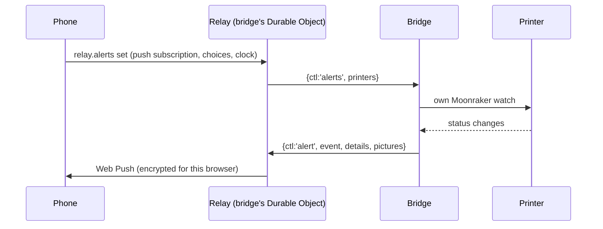

# Print alerts

> **Read this when** you change alerts: which moments, their words, Web Push, the
> Alerts card, or how the bridge watches prints. **Related:** [relay](relay.md),
> [bridge](bridge.md), [print history](print-history.md) (same watch).

## What it does

Phone or computer notifications for a printer, even with every tab closed: failed,
paused or filament out, error and finished by default; started, first layer,
chosen layers, percentages, almost done, still printing, resumed, bed cooled and bridge offline on
request. Each says where the print stands (progress, layer, time left in the phone's own
time zone, filament used) and can carry a camera picture.

## Choosing alerts and cameras

The Alerts card shows each alert as a tile: tapping it turns it on or off. An alert that is
on and has something to set gets a strip along its bottom saying what is set ("50% 80%",
"📷 Nozzle", "📷 2"); tapping the strip opens its settings right under its row, joined to the
tile like a tab (one at a time; turning an alert on opens them). Inside: Progress
percentages, Still printing hours, and the cameras its picture comes from (chips; a switch
when the printer has one camera).

"After layer" holds every chosen layer: `layers` (every print; chips 2 3 5 10 plus any typed
in, starts at 3 when turned on) and `layer` (this print only, also set from the Print dialog,
cleared by the relay when the print ends). Both reach the bridge as its existing `layers`
watch list and fire the `layer` alert, so no bridge update is needed. The old "Third layer"
switch (`layer3`) becomes `layers: [3]` when choices are read (`cleanPrefs`). Its pictures use
the `layer` camera choice. Tiles that are on have an outline in their colour, which runs round
the open tile and its settings as one shape.

Any alert can carry a picture from up to four cameras. A notification shows one picture, so
several are joined into one: two side by side, three or four in a 2×2 grid, each named in its
corner (bridge `alert_picture.go`, browser `device/alert-picture.ts`). Choices are camera
names; one the printer no longer has is skipped, and when none is left its first camera
stands in (`camerasFor`, cases `testdata/camera-cases.json`). New choices start as before:
the first camera (`*`) on the key alerts.

## Pieces

| Part | Where |
|---|---|
| Rules: when an event fires | `apps/web/src/device/alerts.ts` and bridge `alerts.go` (same cases: `testdata/alert-cases.json`) |
| What an alert says | `device/alert-text.ts` (details: `testdata/alert-details-cases.json`) |
| Choices per device and printer | `state/alerts.ts`, `device/ui/AlertsCard.tsx` |
| Cameras for an alert, joining their pictures | `camerasFor` in `device/alerts.ts`, `device/alert-picture.ts`; bridge `cameraList` (`alerts.go`), `alert_picture.go` |
| Permission, service worker, push subscription | `device/push.ts`, `public/sw.js` |
| Watching printers with no page open | bridge `watch.go` |
| Storing subscriptions, sending Web Push | relay `alerts.ts` (`web-push` library, `VAPID_KEY`) |

## How it flows

"Bridge offline" comes from a Durable Object alarm 10 minutes after the bridge drops.
A printer reached directly alerts only while a tab is open: the page runs the same rules.

Pictures: the relay tells the bridge, per alert, every different choice of cameras asked
for (`cameras`); the bridge sends one picture per choice (`pictures`, keyed by the names
joined with newlines, under 900 KB in all for the relay's 1 MB message limit) and the relay
gives each browser the one for its choice. A bridge from before cameras could be chosen
gets `pictures: true` and sends one `picture` from its first camera, which goes to everyone
who asked for any camera.

## What it keeps

Durable Object `push:<hash>` per browser (subscription, choices per printer, time zone);
camera pictures in R2 `alerts/` for a day; the account setting `alerts.last` (a new
device starts from the last choices saved anywhere); `cloud-slicer:alerts:v1` for direct
printers.
Choices kept by an older build are brought up to date every time the relay reads them
(`readSub` in the relay, `cleanPrinterPrefs` in `device/alerts.ts`), so a field added later,
like `cameras`, is never missing when the rules run.

## Rules

- Rules change in both `alerts.ts` and `alerts.go`, with a new case in the shared JSON.
- A **new event** must be added everywhere it is listed, or it is dropped without a word:
  `AlertEvent` and the `PROBLEM_EVENTS`/`MILESTONE_EVENTS`/`DEFAULT_EVENTS`/
  `PICTURE_EVENTS`/`CAMERA_EVENTS` lists (`alerts.ts`), `alerts.go` and `problemEvents` (`watch.go`),
  the relay's `cleanAlert` list and `urgentEvent` (`apps/device-relay/src/alerts.ts`),
  `alert-text.ts`, and the Alerts card's tiles (`AlertsCard.tsx`). Saved choices
  (`cleanPrefs`) drop unknown events, and old bridges won't send it until they update
  (see [bridge](bridge.md) on versions).
- "Filament ran out" is not its own event: it is `paused` with reason `filament`, so it
  shares the Paused switch. Only printers that report a filament sensor send it.
- Titles are plain ("First layer done"), no hints in titles.
- Push addresses must belong to Google, Mozilla, Apple or Microsoft.
- Nothing about an alert is logged.
- Android Chrome 155+ asks with a small Allow bar that times out: no answer is not
  "blocked". iPhone needs the site on the Home Screen (iOS 16.4+), no pictures.

## Why

The bridge watches because it is the only part always near the printer. The relay
encrypts per browser (RFC 8291), so push services see only that a message arrived.
Choices stay per device (a phone may want more than the desk computer); syncing them
live was turned down. See [decisions.md](../decisions.md#device-tab).

## Tests

`device-alerts.mjs` (UI, fakes PushManager; picks two cameras for Finished and checks the
pushed picture is one 1280 × 480 JPEG), `alerts-live.mjs` (pretend push service,
decrypts), bridge `alerts_test.go` and `alert_picture_test.go`.

## Open

- Not built: a pause button in the alert, per-head filament in alerts.
- Printers whose only camera is built in (no Moonraker webcam list) get no pictures.
