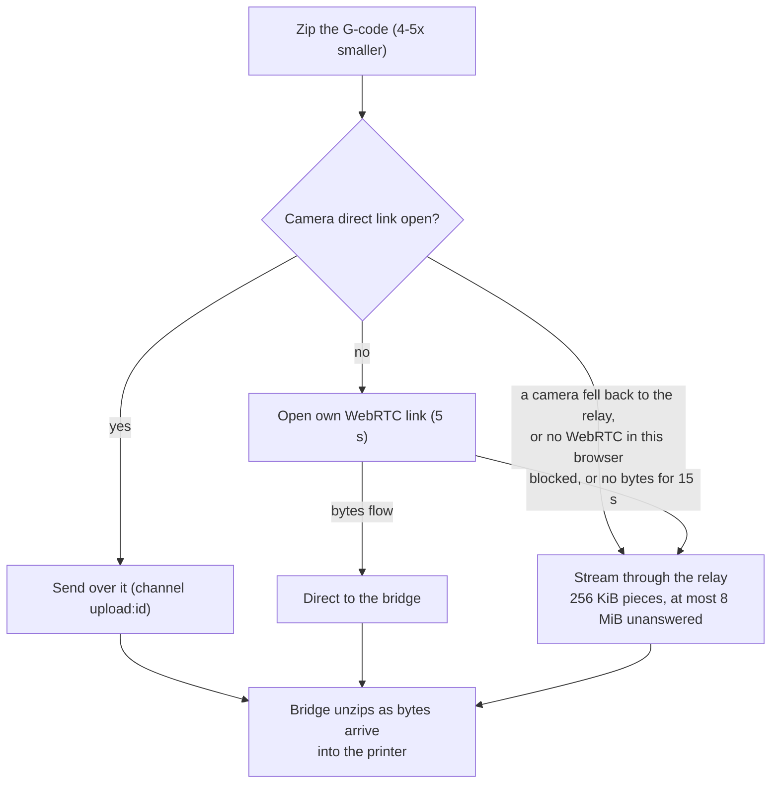

# Send to printer

> **Read this when** you change Download or Send, the Send window, uploads through the
> bridge, or G-code file names. **Related:** [device tab](device-tab.md),
> [bridge](bridge.md), [print history](print-history.md) (the tag line).

## What it does

Sends a sliced plate to a printer: "Upload only" or "Upload and print", fast at home and
still working away from home or on a VPN.

## Pieces

| Part | Where |
|---|---|
| Hand-off from the slicer | `useDevice.getState().requestSend(blob, name, preset)` in `state/device.ts` |
| Send window: printer, tool or AMS mapping, options | `device/ui/PrintDialog.tsx`, `device/slots.ts`, `lib/filament-limit.ts` |
| Upload (zip, direct link, relay stream) | `device/link/upload.ts`, bridge `upload.go` |
| File name from the preset's Filename format | engine `sliceWithConfig` → `result.fileName` |
| `.gcode.3mf` for Bambu Lab and `use_3mf` printers | engine `result.gcode3mfPath` |

## How it flows

The bar says what is happening: Zipping… / Opening a direct link… / "N% through the relay".
Cancel stops the printer's request even after the last byte.

- The zip is kept only when it is at least 10 % smaller (`gzipped` in `upload.ts`).
- Older parts in the field still work: a bridge from before streaming gets 8 MiB pieces
  one at a time; a relay that only passes text gets base64 pieces of 512 KiB; an older
  bridge gets the file the old way (`bridge.upload_begin`).
- A Klipper printer added by a public https address (no bridge) takes the upload straight
  from the browser ([device tab](device-tab.md)).

## Starting a print

Each printer type starts a print the way its maker's own app does. The steps and where
they were read are in `device/addons/print-start-reference.test.ts`; a test fails when an
add-on starts prints its own way without a reference there. Past the bridge, the fakes in
`apps/device-bridge/*_test.go` refuse what the real printer refuses.

| Printer | Start | Copied from |
|---|---|---|
| Snapmaker U1 | `SET_PRINT_EXTRUDER_MAP` per filament, `SET_PRINT_USED_EXTRUDERS`, then `server.files.start_local_print` with `bed_level`, `flow_calibrate`, `time_lapse_camera` and `map_table`. Firmware before 1.3.0 has no such call (-32601): `SET_PRINT_PREFERENCES` then `printer.print.start` | Snapmaker Orca's device page (setPrePrintConfiguration, startPrintMachineLocalFileWithOptions) |
| Bambu Lab | MQTT `print.project_file` with the plate, AMS mapping and checks, built only in `addons/bambu.ts` (the bridge refuses a `.3mf` through `printer.print.start`) | Bambu Studio's print job |
| Elegoo | SDCP Cmd 128 with bed levelling, time-lapse and the plate side the file was sliced for (`curr_bed_type` "Cool Plate" = smooth side) | Orca's ElegooLink |
| Klipper, OctoPrint, PrusaLink | `printer.print.start`; the bridge sends OctoPrint's select + print and PrusaLink's POST on the file | Mainsail and Fluidd, OctoPrint's and PrusaLink's own pages |

- The U1 start G-code only auto-loads, flow-calibrates and pre-extrudes heads marked as
  used, and the firmware clears that list after every print. Without
  `SET_PRINT_USED_EXTRUDERS` no filament loads (the 2026-10-29 bug).
- `start_local_print` lets the printer check each used head's nozzle and filament before
  it starts; it answers a refusal with `{ state: "error" }`, which stops the start
  (`runCalls` in `state/device.ts`) rather than starting another way.
- The pretend U1 (`test/device/mock-printer.mjs`) loads only used heads, like the real one,
  and the device test checks that every head the file uses was loaded.

## Rules

- Never start a print in tests on a real printer: "Upload only" there.
- A U1 maps each filament to a head when sending (several filaments per head allowed).
  A Bambu Lab printer gets a `.gcode.3mf` and picks an AMS
  slot per filament (same type, closest colour). Other printers print filament n from
  slot n.
- Send and Download put the print-history tag line after Orca's header.
- G-code is named by the process preset's Filename format; shipped presets include
  `_plate_{plate_number}`.

## Why

- Plain HTTP upload through the relay and a check for an existing file with the same
  name were both turned down. See [decisions.md](../decisions.md#bridge-and-relay).
- Relay pieces, in two steps. First (#161) "several pieces in flight" was turned down as
  too complicated ("why not just a big chunk"): 8 MiB pieces, one at a time. Then (#172)
  the bar jumped 0 → 100 % and a VPN user saw it stuck, so it now streams 256 KiB pieces
  back to back with at most 8 MiB unanswered. A bridge from before #172 still gets 8 MiB
  pieces one at a time.
- The upload's own direct link has 5 s to open and is then dropped only when it carries
  **nothing** for 15 s (`DIRECT_STALL_MS`); a slow but moving direct link (one routed
  over a VPN, say) is kept. Direct links use STUN only, no TURN.
- The bridge answers a relay piece once Moonraker has taken it (the write into the
  upload request blocks), so the printer's own speed sets the pace.
- The free-tier budget counts each relay piece as an incoming message (20 to 1, see
  [relay](relay.md#free-tier-budget)): a 40 MB zipped file is about 160 pieces.

## Tests

`device-upload.mjs` (direct and relay only), `device-smoke.mjs`; bridge `upload_test.go`.

## Open

- The VPN case (camera fell back, so direct is skipped) has no end-to-end test.
